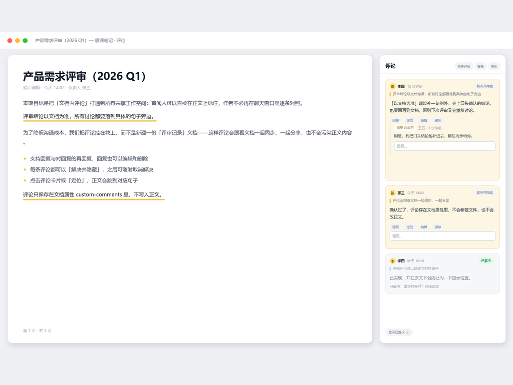
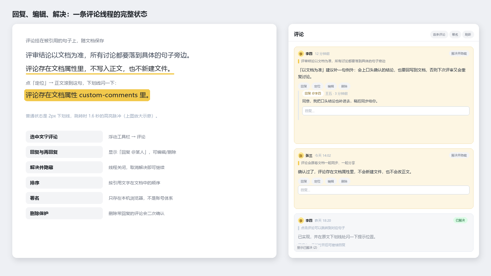

# 拓展评论 · Extended Comments

给思源笔记加上「像飞书 / Google Docs 那样」的文档内评论：**选中文字 → 评论 → 在右侧面板讨论**，被评论的原文带黄色下划线，评论跟着文档一起保存、一起分享。

## 它能做什么

- **选中文字即可评论**：选中正文 → 点浮动工具栏的「评论」→ 在右侧面板输入（`Ctrl/Cmd + Enter` 保存）
- **回复可以再回复**：回复条目显示「回复 @某人」，点 ✕ 可取消指名、改回回复整条评论
- **评论和回复都能编辑、删除**：作者本人可改，改过会标「已编辑」；删除带回复的评论时会二次确认
- **解决并隐藏**：一条评论讨论完就「解决并隐藏」，之后可以「取消解决」；已解决的线程会关闭回复入口
- **点评论就跳转**：点卡片、「定位」按钮或引用的文字 → 正文滚到对应句子，并在下划线处闪烁 1.6 秒提示位置；「首条评论」一键回到开头
- **按正文顺序排列**：评论按「引用的文字在文档中出现的位置」排序，而不是按发表时间
- **头像与相对时间**：首字母彩色圆形头像；时间显示为「刚刚 / 12 分钟前 / 今天 14:32 / 昨天 09:05」，鼠标悬停看完整时间
- **引用可点**：卡片顶部引用的那行文字可以点击，直接跳到正文

## 安装与使用

1. 集市 → 插件 → 搜索「拓展评论」下载并启用；本地包则用 集市 → 已下载 → 启用（刚更新过请 `Ctrl+Shift+R` 强制刷新）
2. 首次使用点面板里的「署名」填写显示名（**只保存在本机浏览器**，不是账号体系）
3. 选中正文文字 → 点浮动工具栏的「评论」→ 输入 → 保存

## 数据存在哪里

评论以 JSON 形式保存在文档块的 `custom-comments` 属性里：

- **不新建文件、不修改正文内容**，只是给文档块加一个属性
- 跟着文档一起同步、一起分享：谁打开这篇文档，谁就能看到这些评论
- 删除插件不会删除评论数据，重新启用即可恢复显示

## 开发

    npm install
    npm run build                  # 产出 dist/，同时生成 package.zip
    python scripts/make-assets.py  # 重新生成 icon-0.7.0.png / preview*.png

`src/index.ts` 是全部逻辑（数据层、持久化、面板渲染、action 分发），`src/index.scss` 是样式，`src/i18n/*.json` 是文案。

## 许可

MIT
